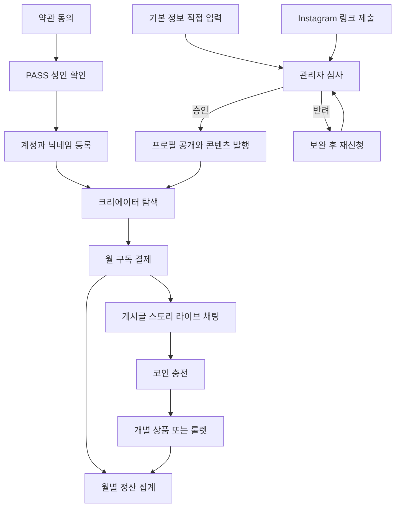

# 밤결 서비스 기획

밤결(BAMGYEOL)은 크리에이터와 구독자를 연결하는 모바일 우선 반응형 웹이다. 짙은 네이비와 청록, 궤도를 그리는 로고, 화면별 주요 버튼 하나를 브랜드 가안으로 사용한다. 홈은 스토리·라이브와 세로 피드, 검색은 구독자 수에 따른 가변 크기 원형 탐색을 사용한다.

## 정산과 정책

- 원본 슬라이드 1·2의 Instagram 정산 메모는 월별 집계, 지급 기준액, 계좌 확인, 세무 양식의 비교 자료다. 실서비스 정책은 결제사와 세무 검토를 거쳐 별도로 확정한다.
- 구독권과 코인은 각각 크리에이터 명의의 미국 가상 수취 계좌를 쓰는 방식과 회사가 수취 후 배분하는 방식을 비교한다. 코인 충전·사용·환불을 분리하고, 크리에이터별 코인 소비량을 월 집계하는 가안을 검토한다.
- 1차 영입은 팔로워 상한을 정해 DM으로 제안하고, 합류한 크리에이터가 자신의 Instagram에 홍보한다. 초기 구독 플랫폼 수수료 0% 인원·기간과 결제 비용 부담을 공동창업자가 결정한다.
- 룰렛 데모에는 상품명과 당첨 확률, 코인 소모량, 선택적인 1등 확정 구매를 표시한다. 원판 칸 크기는 실제 추첨 확률에 비례한다. 유료 운영 전 확률 고지·보상·누적 소비 조건을 법무·결제사와 검토한다.

## 보호와 마케팅

구독 전용 게시글·스토리·라이브 미리보기와 개별 상품 원본에는 비활성 화면 가림과 우클릭·드래그·인쇄 억제를 적용한다. React 앱 최상단에서 화면 비활성화와 인쇄 가림 훅을 각각 호출하고, 보호 영역과 미리보기 제목에 같은 상태를 적용한다. 보호된 개별 판매 영상은 화면이 가려지면 일시 정지하고 사용자가 재생을 다시 시작한다.

Vite 개발·미리보기와 Cloudflare Pages의 `display-capture=()` 응답 헤더는 지원 브라우저에서 이 문서가 `getDisplayMedia()`로 화면 공유를 시작하는 것을 제한한다. 데스크톱·iOS·Android에서 OS 캡처·녹화 또는 다른 앱이 시작한 화면 공유는 웹에서 제어할 수 없다.

운영 단계의 영상 DRM은 암호화 스트리밍, 구독·구매 권한 확인, 재생 라이선스가 필요하다. 지원 기기에서 보호 영상이 캡처에서 빠지는지 확인한다. 사진·게시글의 원본은 비공개로 저장하고, 서버에서 열람 권한을 확인한 뒤 짧게 만료되는 링크를 발급하는 방식으로 설계한다.

마케팅 문구 가안은 “구독 전용 콘텐츠는 구독 중인 회원만 열람할 수 있습니다.”로 한다.

[W3C Screen Capture](https://www.w3.org/TR/screen-capture/) · [W3C 암호화 미디어](https://www.w3.org/TR/encrypted-media-1/) · [Cloudflare 서명 URL](https://developers.cloudflare.com/stream/viewing-videos/securing-your-stream/)
