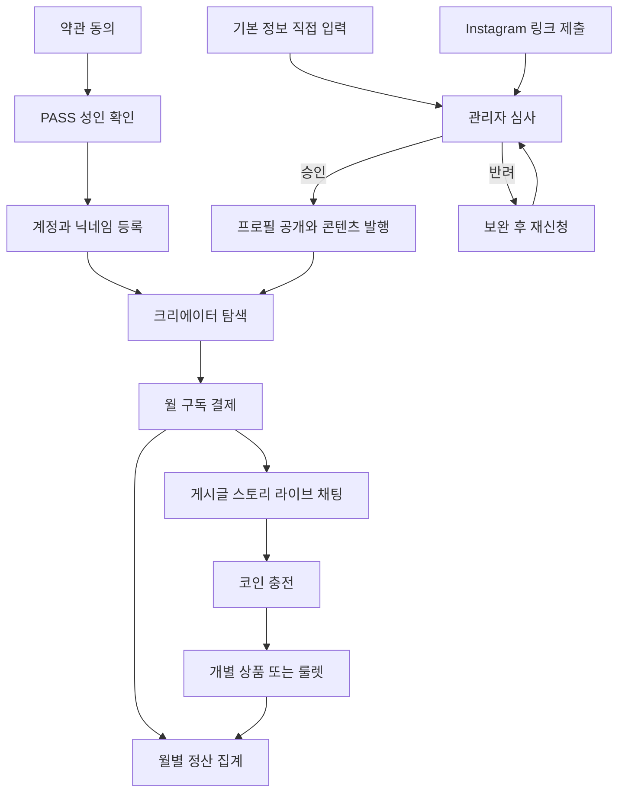

# 밤결 서비스 기획

밤결(BAMGYEOL)은 크리에이터와 구독자를 연결하는 모바일 우선 반응형 웹이다. 짙은 네이비와 청록, 궤도를 그리는 로고, 화면별 주요 버튼 하나를 브랜드 가안으로 사용한다. 홈은 스토리·라이브와 세로 피드, 검색은 구독자 수에 따른 가변 크기 원형 탐색을 사용한다.

## 정산과 정책

- 원본 슬라이드 1·2의 Instagram 정산 메모는 월별 집계, 지급 기준액, 계좌 확인, 세무 양식의 비교 자료다. 실서비스 정책은 결제사와 세무 검토를 거쳐 별도로 확정한다.
- 구독권과 코인은 각각 크리에이터 명의의 미국 가상 수취 계좌를 쓰는 방식과 회사가 수취 후 배분하는 방식을 비교한다. 코인 충전·사용·환불을 분리하고, 크리에이터별 코인 소비량을 월 집계하는 가안을 검토한다.
- 1차 영입은 팔로워 상한을 정해 DM으로 제안하고, 합류한 크리에이터가 자신의 Instagram에 홍보한다. 초기 구독 플랫폼 수수료 0% 인원·기간과 결제 비용 부담을 공동창업자가 결정한다.
- 룰렛에는 공개 확률과 소모량을 제시한다. 유료 보상, 누적 소비액 조건, 최고 상품 확정가는 법무·결제사 검토 후 결정한다.

## 보호와 마케팅

구독 전용 게시글·스토리·라이브 미리보기는 데모에서 계정 ID 워터마크, 비활성 탭 가림, 우클릭·드래그·인쇄 억제를 적용한다. Cloudflare Pages의 `display-capture=()`는 사이트 문서가 화면 공유를 시작하는 API를 제한한다. OS 또는 다른 앱의 캡처·녹화는 모바일·데스크톱 웹에서 차단할 수 없다. 운영 단계에서는 서버 구독 검사, 비공개 미디어, 만료 URL, 영상 DRM·네이티브 보호 범위를 검토한다.

마케팅 문구 가안은 “구독자만 열람할 수 있고, 이용자별 워터마크와 신고 대응으로 무단 공유를 억제합니다.”로 한다.

[W3C Screen Capture](https://www.w3.org/TR/screen-capture/) · [MDN display-capture](https://developer.mozilla.org/en-US/docs/Web/HTTP/Reference/Headers/Permissions-Policy/display-capture)
